<!-- @format -->

<p align="center">
  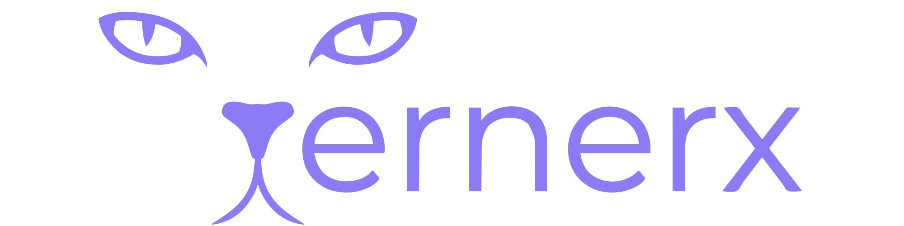
</p>

<h1 align="center">Xernerx Studios — Official Brand &amp; Press Kit</h1>

<p align="center">
  <b>1 Account, 1 Place, 1 Setup</b><br />
  Official brand guidelines, typography specifications, 27-color palette tokens, logos, icons, banners, and SDK media assets for <b>Xernerx Studios</b>.
</p>

<p align="center">
  <a href="./brand/brand.json"></a>
  <a href="https://www.xernerx.com"></a>
  <a href="https://docs.xernerx.com/packages"></a>
</p>

---

## 📑 Table of Contents

1. [Core Brand Identity](#-core-brand-identity)
2. [Official Typography](#-official-typography)
3. [Primary Brand Marks (Logos, Icons & Banners)](#-primary-brand-marks-logos-icons--banners)
4. [Core Surface & Theme Tokens](#-core-surface--theme-tokens)
5. [Official 27-Color Xernerx Palette](#-official-27-color-xernerx-palette)
6. [Official Discord Applications Media Kit (`Virtue`, `YourApps`, `TDL`, `Zodiac` & `Metamorphosis`)](#-official-discord-applications-media-kit-virtue-yourapps-tdl-zodiac--metamorphosis)
7. [Official SDK Package Media Kit (`@xernerx/*`)](#-official-sdk-package-media-kit-xernerx)
8. [Brand Usage Guidelines](#-brand-usage-guidelines)

---

## 🏛️ Core Brand Identity

- **Organization Name:** `Xernerx Studios` (short form: `Xernerx`)
- **Platform Suite Name:** `Xernerx Suite`
- **Official Slogan:** `1 Account, 1 Place, 1 Setup`
- **Signature Brand Color:** **Xernerx Purple** (`#8b7cf6` / `rgb(139, 124, 246)`)
- **Machine-Readable Manifest:** [`./brand/brand.json`](./brand/brand.json) (also hosted at [`https://www.xernerx.com/brand.json`](https://www.xernerx.com/brand.json))
- **UI & Component Design System Specification:** [`../suite/DESIGN.md`](../suite/DESIGN.md) (*Modern Round Glassmorphism Pop*, Tailwind CSS v4 tokens, geometry, and `@xernerx/ui` primitives)

---

## 🔤 Official Typography

All **Xernerx Suite** web applications, desktop clients, and developer portals use two official open-source typefaces loaded via Google Fonts and exposed through [`@xernerx/styles`](https://github.com/Xernerx):

| Role | Typeface | CSS Variable | Weights | Fallback Stack | Download / Specimen |
| :--- | :--- | :--- | :--- | :--- | :--- |
| **Primary UI, Headings & Display** | **Fredoka** | `--font-fredoka` | `300`, `400`, `500`, `600`, `700` | `system-ui, -apple-system, sans-serif` | [Google Fonts: Fredoka](https://fonts.google.com/specimen/Fredoka) |
| **Monospace, Code, CLI & Keybinds** | **Cascadia Code** | `--font-cascadia` | `400`, `600`, `700` | `ui-monospace, SFMono-Regular, Menlo, monospace` | [Google Fonts: Cascadia Code](https://fonts.google.com/specimen/Cascadia+Code) |

### CSS Implementation

```css
@import url('https://fonts.googleapis.com/css2?family=Cascadia+Code:wght@400..700&family=Fredoka:wght@300..700&display=swap');

:root {
	--font-fredoka: 'Fredoka', system-ui, -apple-system, sans-serif;
	--font-cascadia: 'Cascadia Code', ui-monospace, SFMono-Regular, Menlo, monospace;
}

body {
	font-family: var(--font-fredoka);
}

code,
pre,
kbd {
	font-family: var(--font-cascadia);
}
```

---

## 🛡️ Primary Brand Marks (Logos, Icons & Banners)

Xernerx Studios uses three primary brand marks. Vector `.svg` files in [`./brand/`](./brand) include both `currentColor` adaptive templates (`logo.svg`, `icon.svg`, `banner.svg`) and pre-colored variants across all 27 official Xernerx colors.

| Mark | Preview | Dimensions | Formats | Primary Use Case | Default Downloads |
| :--- | :---: | :---: | :---: | :--- | :--- |
| **Xernerx Winged Crest (`logo`)** | 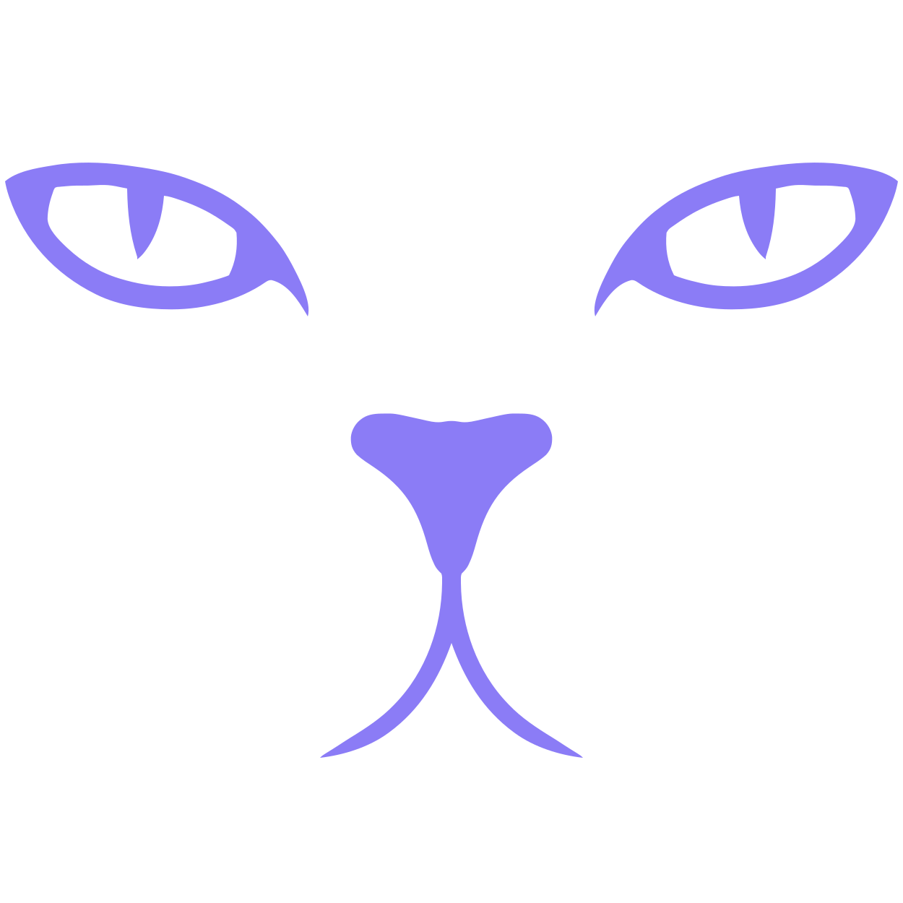 | `1250 × 1250` | `.svg`, `.png` | Transparent standalone crest for headers, watermarks, hero graphics, and partner badges. | [SVG (`currentColor`)](./brand/logos/logo.svg) · [SVG (`purple`)](./brand/logos/logo-purple.svg) · [PNG](./brand/logos/logo.png) |
| **Xernerx App Badge (`icon`)** | 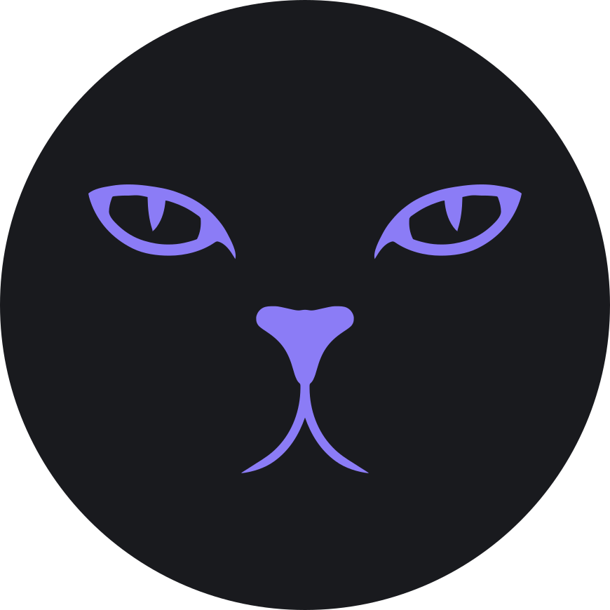 | `870 × 870` | `.svg`, `.png`, `.ico` | Circular badge (`#191a1e` dark surface fill) for app icons, avatars, favicons, and desktop shortcuts. | [SVG (`currentColor`)](./brand/icons/icon.svg) · [SVG (`purple`)](./brand/icons/icon-purple.svg) · [PNG](./brand/icons/icon.png) · [ICO](./brand/icons/icon.ico) |
| **Xernerx Wordmark (`banner`)** |  | `2000 × 990` | `.svg`, `.png` | Full horizontal winged crest + `xernerx` wordmark for repository headers, OpenGraph cards, and press headers. | [SVG (`currentColor`)](./brand/banners/banner.svg) · [SVG (`purple`)](./brand/banners/banner-purple.svg) · [PNG](./brand/banners/banner.png) |
| **Environment Wordmarks (`canary` / `dev`)** |  | `2000 × 500` | `.svg` | Official environment indicator banners for `.canary.xernerx.com` and `.dev.xernerx.com`. | [Canary SVG](./brand/banners/banner-canary.svg) · [Dev SVG](./brand/banners/banner-dev.svg) |

---

## 🌗 Core Surface & Theme Tokens

These surface tokens define the dark and light theme foundations in `@xernerx/styles`:

| Swatch | Token Name | CSS Variable | Hex | RGB | Usage |
| :---: | :--- | :--- | :--- | :--- | :--- |
|  | **Background (Dark)** | `--background-dark` | `#09090b` | `rgb(9, 9, 11)` | Primary app canvas in Dark Mode |
|  | **Foreground / Card (Dark)** | `--foreground-dark` | `#18181b` | `rgb(24, 24, 27)` | Elevated cards, panels, and modals in Dark Mode |
|  | **Icon Badge Surface (Dark)** | *Icon disc fill* | `#191a1e` | `rgb(25, 26, 30)` | Circular badge background on `icon-*.svg` |
|  | **Border (Dark)** | `--border-dark` | `#f4f4f5` | `rgb(244, 244, 245)` | Subtle structural borders (with opacity modifiers) |
|  | **Primary Text (Dark)** | `--text` | `#fafafa` | `rgb(250, 250, 250)` | Primary body & heading text in Dark Mode |
|  | **Muted Text (Dark)** | `--text-muted` | `#a1a1aa` | `rgb(161, 161, 170)` | Secondary labels & metadata in Dark Mode |
|  | **Background (Light)** | `--background-light` | `#fafafa` | `rgb(250, 250, 250)` | Primary app canvas in Light Mode |
|  | **Foreground / Card (Light)** | `--foreground-light` | `#f4f4f5` | `rgb(244, 244, 245)` | Elevated cards, panels, and Light Mode icon disc fill |
|  | **Border (Light)** | `--border-light` | `#53535b` | `rgb(83, 83, 91)` | Subtle structural borders in Light Mode |
|  | **Primary Text (Light)** | `--text` | `#09090b` | `rgb(9, 9, 11)` | Primary body & heading text in Light Mode |
|  | **Muted Text (Light)** | `--text-muted` | `#52525b` | `rgb(82, 82, 91)` | Secondary labels & metadata in Light Mode |

---

## 🎨 Official 27-Color Xernerx Palette

Every official Xernerx accent color has pre-rendered **Crest Logos** (`1250×1250`), **App Icons** (`870×870` + multi-size `.ico`), and **Wordmark Banners** (`2000×990`) available in both [`./brand/`](./brand) and across all `*.xernerx.com` origins:

| Swatch | Icon | Color Name | Key | Hex | RGB | Crest Logo (`1250×1250`) | App Icon (`870×870`) | Wordmark Banner (`2000×990`) |
| :---: | :---: | :--- | :--- | :--- | :--- | :---: | :---: | :---: |
|  |  | **Purple** *(Default)* | `purple` | `#8b7cf6` | `rgb(139, 124, 246)` | [SVG](./brand/logos/logo-purple.svg) · [PNG](./brand/logos/logo-purple.png) | [SVG](./brand/icons/icon-purple.svg) · [PNG](./brand/icons/icon-purple.png) · [ICO](./brand/icons/icon-purple.ico) | [SVG](./brand/banners/banner-purple.svg) · [PNG](./brand/banners/banner-purple.png) |
|  | 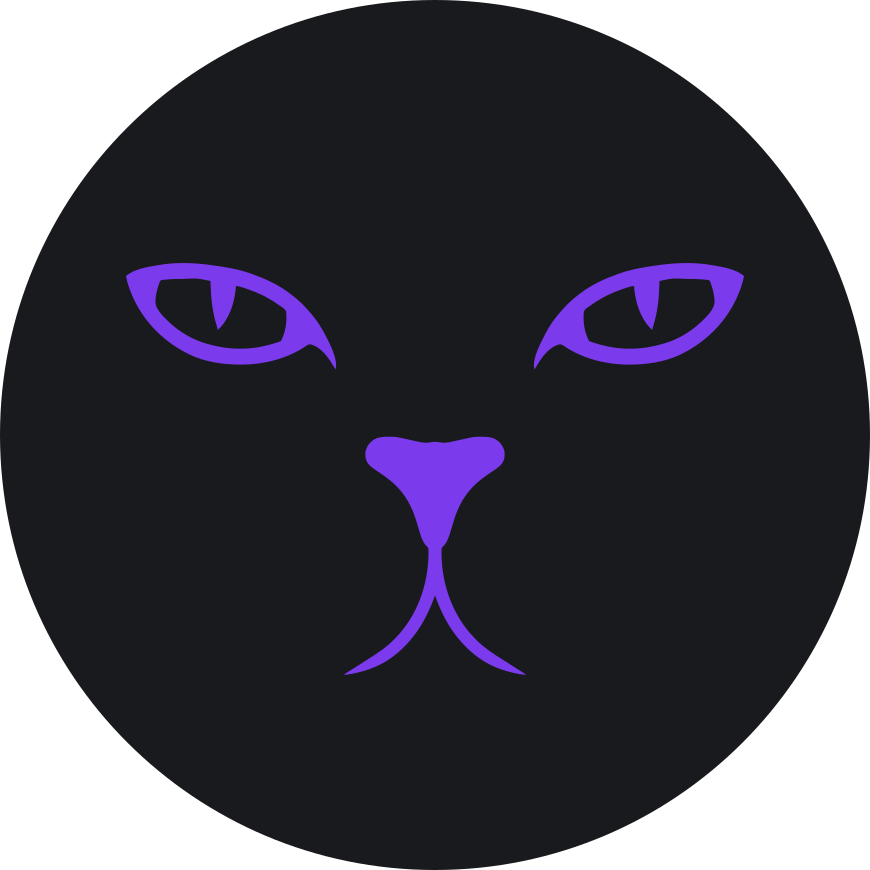 | **Violet** | `violet` | `#7c3aed` | `rgb(124, 58, 237)` | [SVG](./brand/logos/logo-violet.svg) · [PNG](./brand/logos/logo-violet.png) | [SVG](./brand/icons/icon-violet.svg) · [PNG](./brand/icons/icon-violet.png) · [ICO](./brand/icons/icon-violet.ico) | [SVG](./brand/banners/banner-violet.svg) · [PNG](./brand/banners/banner-violet.png) |
|  | 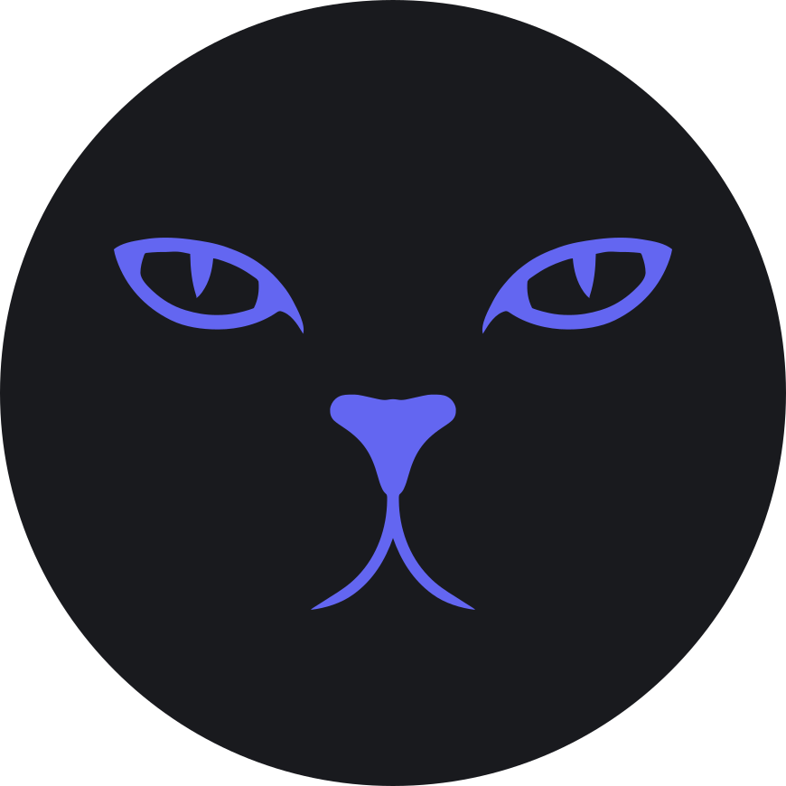 | **Indigo** | `indigo` | `#6366f1` | `rgb(99, 102, 241)` | [SVG](./brand/logos/logo-indigo.svg) · [PNG](./brand/logos/logo-indigo.png) | [SVG](./brand/icons/icon-indigo.svg) · [PNG](./brand/icons/icon-indigo.png) · [ICO](./brand/icons/icon-indigo.ico) | [SVG](./brand/banners/banner-indigo.svg) · [PNG](./brand/banners/banner-indigo.png) |
|  | 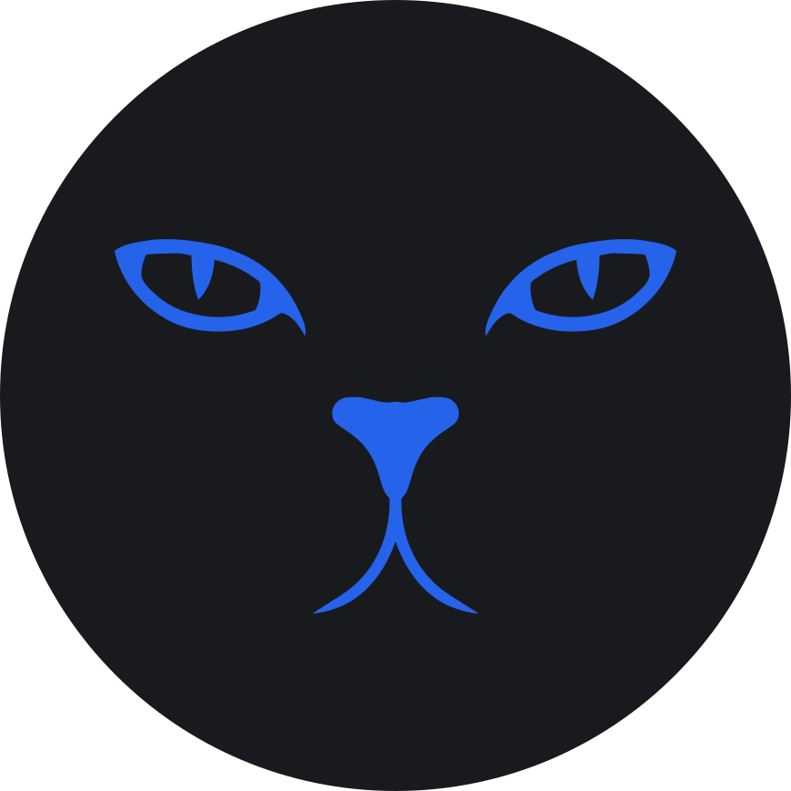 | **Cobalt** | `cobalt` | `#2563eb` | `rgb(37, 99, 235)` | [SVG](./brand/logos/logo-cobalt.svg) · [PNG](./brand/logos/logo-cobalt.png) | [SVG](./brand/icons/icon-cobalt.svg) · [PNG](./brand/icons/icon-cobalt.png) · [ICO](./brand/icons/icon-cobalt.ico) | [SVG](./brand/banners/banner-cobalt.svg) · [PNG](./brand/banners/banner-cobalt.png) |
|  | 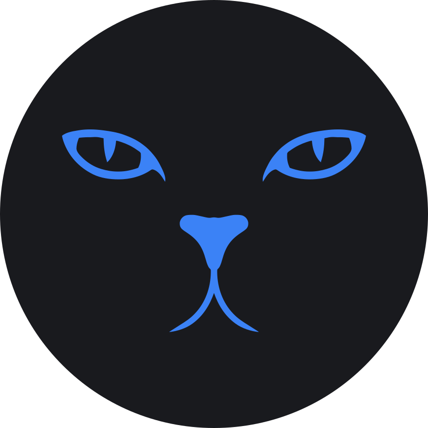 | **Blue** | `blue` | `#3b82f6` | `rgb(59, 130, 246)` | [SVG](./brand/logos/logo-blue.svg) · [PNG](./brand/logos/logo-blue.png) | [SVG](./brand/icons/icon-blue.svg) · [PNG](./brand/icons/icon-blue.png) · [ICO](./brand/icons/icon-blue.ico) | [SVG](./brand/banners/banner-blue.svg) · [PNG](./brand/banners/banner-blue.png) |
|  | 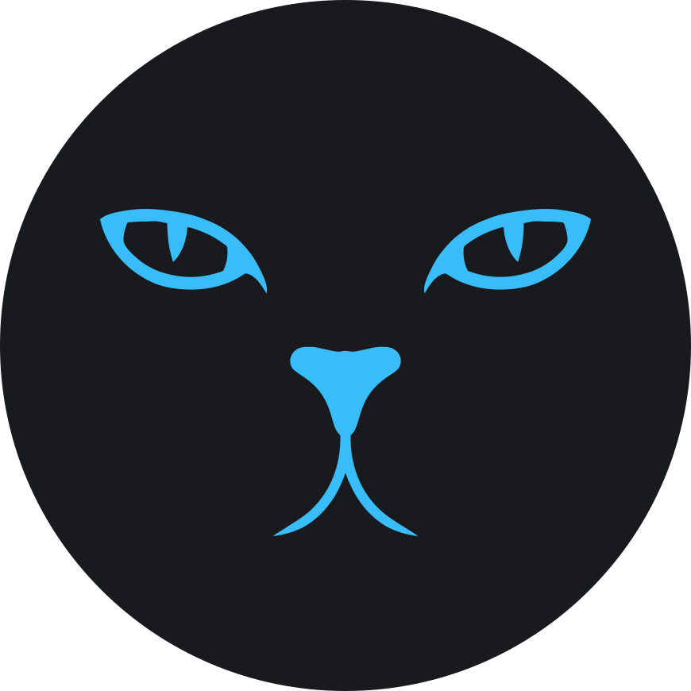 | **Sky** | `sky` | `#38bdf8` | `rgb(56, 189, 248)` | [SVG](./brand/logos/logo-sky.svg) · [PNG](./brand/logos/logo-sky.png) | [SVG](./brand/icons/icon-sky.svg) · [PNG](./brand/icons/icon-sky.png) · [ICO](./brand/icons/icon-sky.ico) | [SVG](./brand/banners/banner-sky.svg) · [PNG](./brand/banners/banner-sky.png) |
|  | 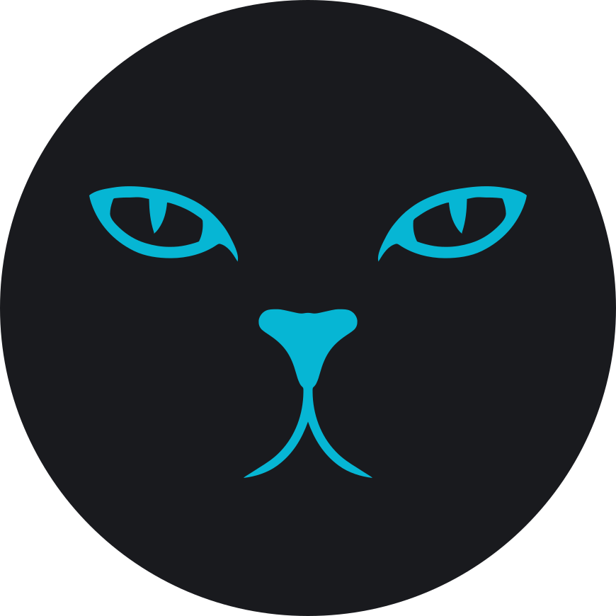 | **Cyan** | `cyan` | `#06b6d4` | `rgb(6, 182, 212)` | [SVG](./brand/logos/logo-cyan.svg) · [PNG](./brand/logos/logo-cyan.png) | [SVG](./brand/icons/icon-cyan.svg) · [PNG](./brand/icons/icon-cyan.png) · [ICO](./brand/icons/icon-cyan.ico) | [SVG](./brand/banners/banner-cyan.svg) · [PNG](./brand/banners/banner-cyan.png) |
|  | 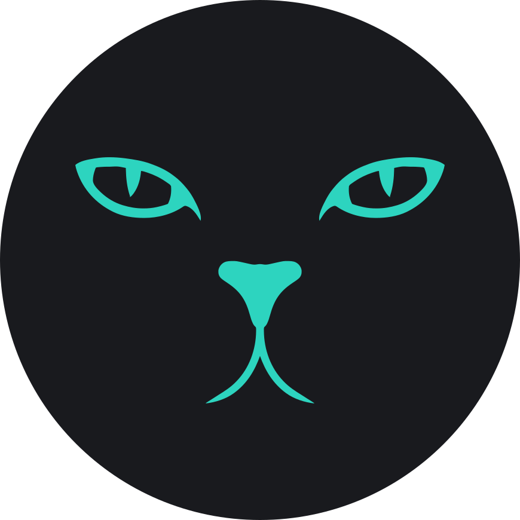 | **Mint** | `mint` | `#2dd4bf` | `rgb(45, 212, 191)` | [SVG](./brand/logos/logo-mint.svg) · [PNG](./brand/logos/logo-mint.png) | [SVG](./brand/icons/icon-mint.svg) · [PNG](./brand/icons/icon-mint.png) · [ICO](./brand/icons/icon-mint.ico) | [SVG](./brand/banners/banner-mint.svg) · [PNG](./brand/banners/banner-mint.png) |
|  | 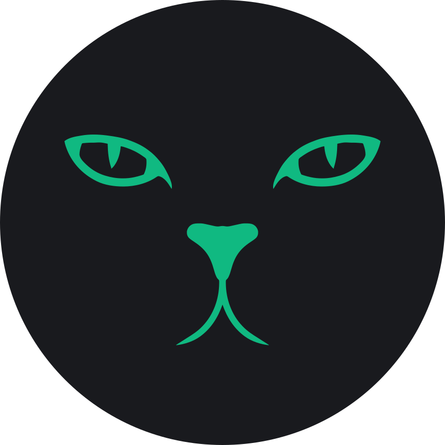 | **Emerald** | `emerald` | `#10b981` | `rgb(16, 185, 129)` | [SVG](./brand/logos/logo-emerald.svg) · [PNG](./brand/logos/logo-emerald.png) | [SVG](./brand/icons/icon-emerald.svg) · [PNG](./brand/icons/icon-emerald.png) · [ICO](./brand/icons/icon-emerald.ico) | [SVG](./brand/banners/banner-emerald.svg) · [PNG](./brand/banners/banner-emerald.png) |
|  | 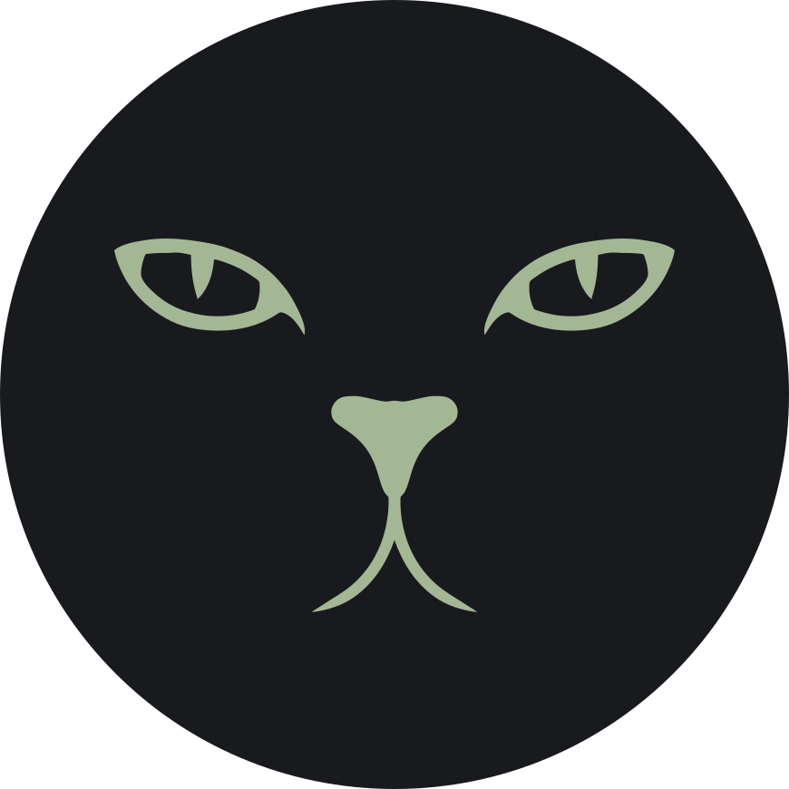 | **Green** | `green` | `#a4b795` | `rgb(164, 183, 149)` | [SVG](./brand/logos/logo-green.svg) · [PNG](./brand/logos/logo-green.png) | [SVG](./brand/icons/icon-green.svg) · [PNG](./brand/icons/icon-green.png) · [ICO](./brand/icons/icon-green.ico) | [SVG](./brand/banners/banner-green.svg) · [PNG](./brand/banners/banner-green.png) |
|  | 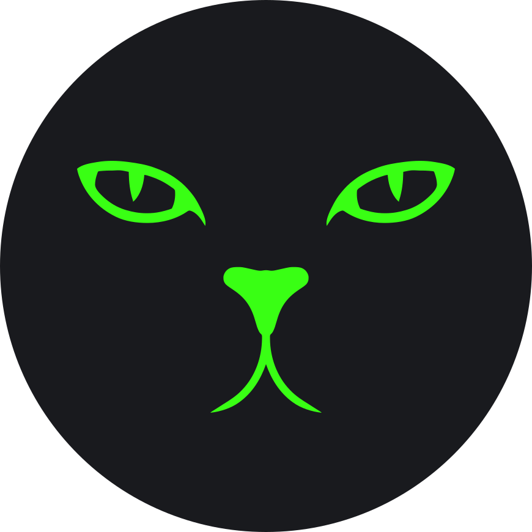 | **Neon** | `neon` | `#39ff14` | `rgb(57, 255, 20)` | [SVG](./brand/logos/logo-neon.svg) · [PNG](./brand/logos/logo-neon.png) | [SVG](./brand/icons/icon-neon.svg) · [PNG](./brand/icons/icon-neon.png) · [ICO](./brand/icons/icon-neon.ico) | [SVG](./brand/banners/banner-neon.svg) · [PNG](./brand/banners/banner-neon.png) |
|  | 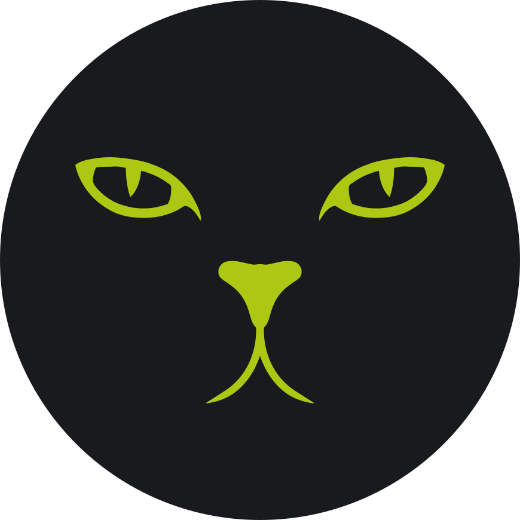 | **Lime** | `lime` | `#acc813` | `rgb(172, 200, 19)` | [SVG](./brand/logos/logo-lime.svg) · [PNG](./brand/logos/logo-lime.png) | [SVG](./brand/icons/icon-lime.svg) · [PNG](./brand/icons/icon-lime.png) · [ICO](./brand/icons/icon-lime.ico) | [SVG](./brand/banners/banner-lime.svg) · [PNG](./brand/banners/banner-lime.png) |
|  | 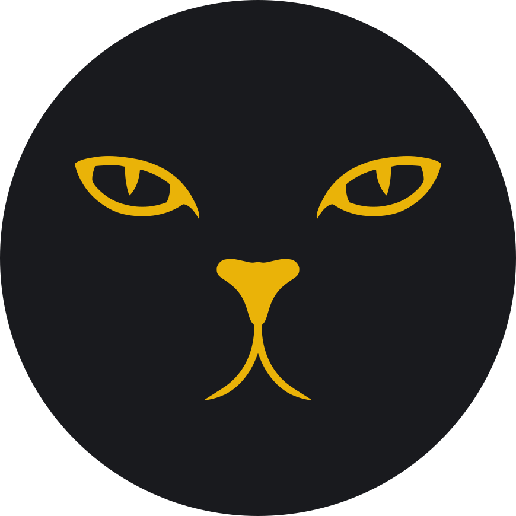 | **Yellow** | `yellow` | `#eab308` | `rgb(234, 179, 8)` | [SVG](./brand/logos/logo-yellow.svg) · [PNG](./brand/logos/logo-yellow.png) | [SVG](./brand/icons/icon-yellow.svg) · [PNG](./brand/icons/icon-yellow.png) · [ICO](./brand/icons/icon-yellow.ico) | [SVG](./brand/banners/banner-yellow.svg) · [PNG](./brand/banners/banner-yellow.png) |
|  | 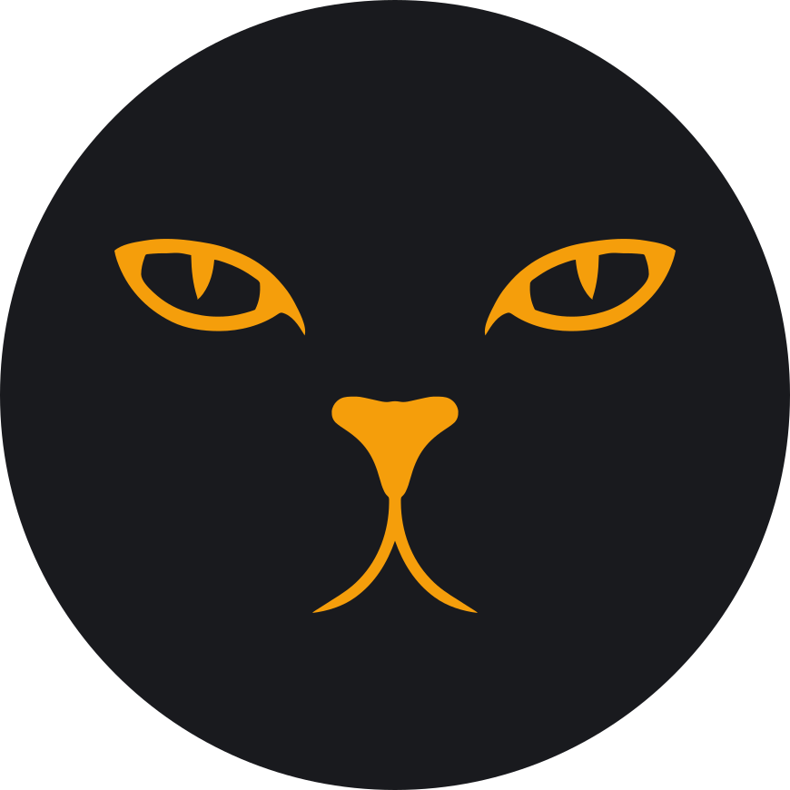 | **Gold** | `gold` | `#f59e0b` | `rgb(245, 158, 11)` | [SVG](./brand/logos/logo-gold.svg) · [PNG](./brand/logos/logo-gold.png) | [SVG](./brand/icons/icon-gold.svg) · [PNG](./brand/icons/icon-gold.png) · [ICO](./brand/icons/icon-gold.ico) | [SVG](./brand/banners/banner-gold.svg) · [PNG](./brand/banners/banner-gold.png) |
|  | 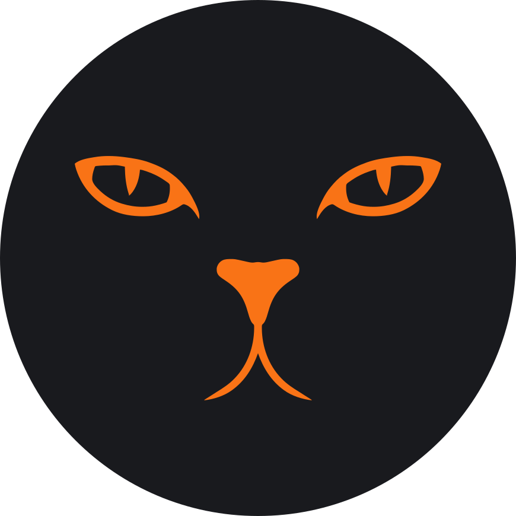 | **Orange** | `orange` | `#f97316` | `rgb(249, 115, 22)` | [SVG](./brand/logos/logo-orange.svg) · [PNG](./brand/logos/logo-orange.png) | [SVG](./brand/icons/icon-orange.svg) · [PNG](./brand/icons/icon-orange.png) · [ICO](./brand/icons/icon-orange.ico) | [SVG](./brand/banners/banner-orange.svg) · [PNG](./brand/banners/banner-orange.png) |
|  | 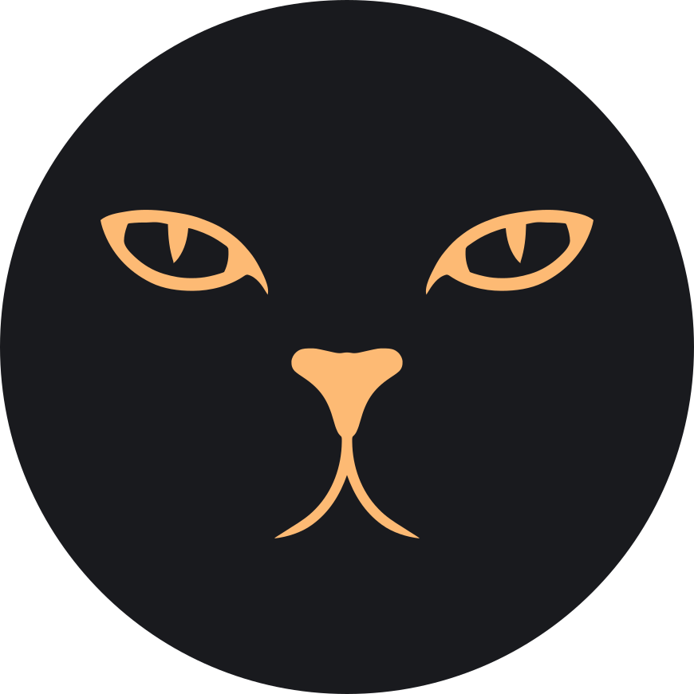 | **Peach** | `peach` | `#fdba74` | `rgb(253, 186, 116)` | [SVG](./brand/logos/logo-peach.svg) · [PNG](./brand/logos/logo-peach.png) | [SVG](./brand/icons/icon-peach.svg) · [PNG](./brand/icons/icon-peach.png) · [ICO](./brand/icons/icon-peach.ico) | [SVG](./brand/banners/banner-peach.svg) · [PNG](./brand/banners/banner-peach.png) |
|  | 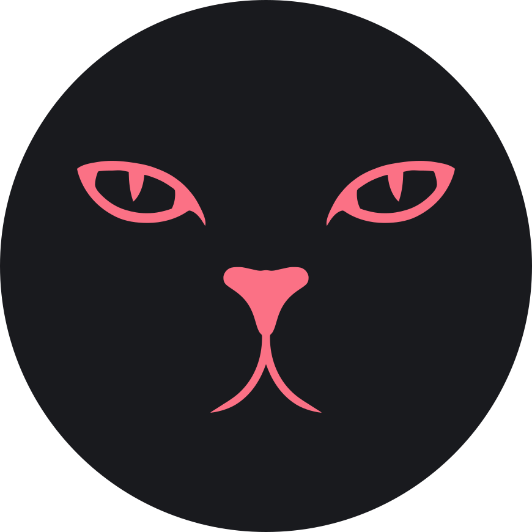 | **Coral** | `coral` | `#fb7185` | `rgb(251, 113, 133)` | [SVG](./brand/logos/logo-coral.svg) · [PNG](./brand/logos/logo-coral.png) | [SVG](./brand/icons/icon-coral.svg) · [PNG](./brand/icons/icon-coral.png) · [ICO](./brand/icons/icon-coral.ico) | [SVG](./brand/banners/banner-coral.svg) · [PNG](./brand/banners/banner-coral.png) |
|  |  | **Crimson** | `crimson` | `#ef4444` | `rgb(239, 68, 68)` | [SVG](./brand/logos/logo-crimson.svg) · [PNG](./brand/logos/logo-crimson.png) | [SVG](./brand/icons/icon-crimson.svg) · [PNG](./brand/icons/icon-crimson.png) · [ICO](./brand/icons/icon-crimson.ico) | [SVG](./brand/banners/banner-crimson.svg) · [PNG](./brand/banners/banner-crimson.png) |
|  | 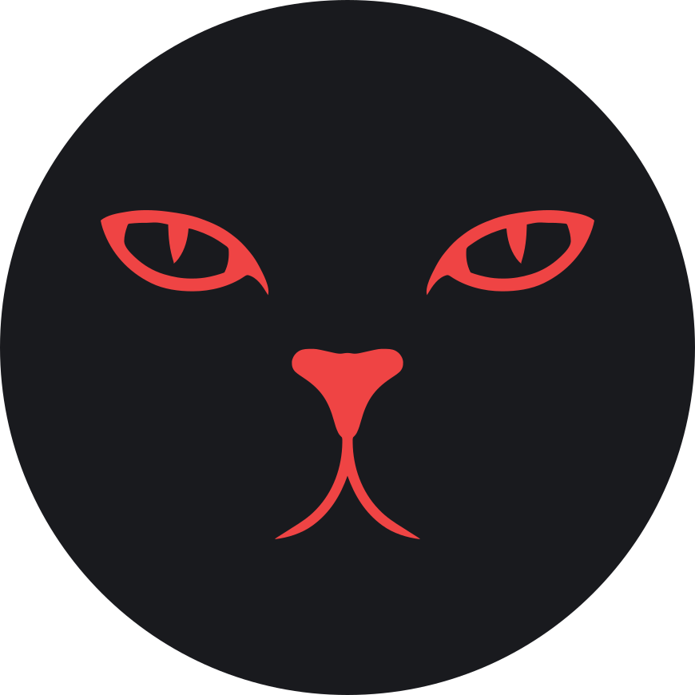 | **Red** | `red` | `#ef4444` | `rgb(239, 68, 68)` | [SVG](./brand/logos/logo-red.svg) · [PNG](./brand/logos/logo-red.png) | [SVG](./brand/icons/icon-red.svg) · [PNG](./brand/icons/icon-red.png) · [ICO](./brand/icons/icon-red.ico) | [SVG](./brand/banners/banner-red.svg) · [PNG](./brand/banners/banner-red.png) |
|  | 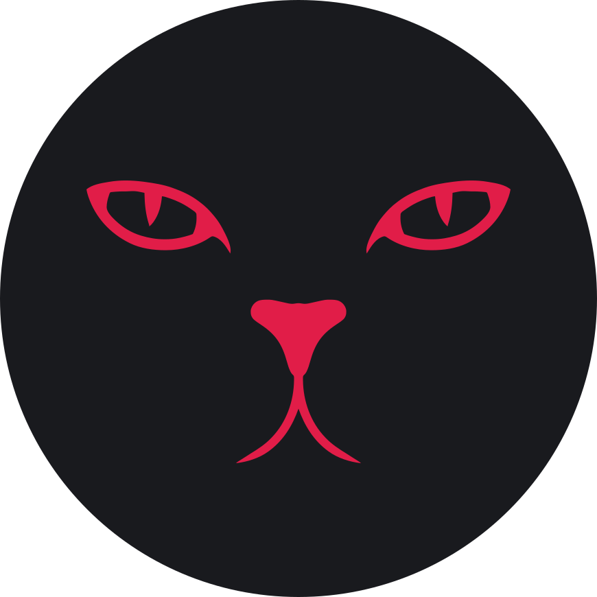 | **Berry** | `berry` | `#e11d48` | `rgb(225, 29, 72)` | [SVG](./brand/logos/logo-berry.svg) · [PNG](./brand/logos/logo-berry.png) | [SVG](./brand/icons/icon-berry.svg) · [PNG](./brand/icons/icon-berry.png) · [ICO](./brand/icons/icon-berry.ico) | [SVG](./brand/banners/banner-berry.svg) · [PNG](./brand/banners/banner-berry.png) |
|  | 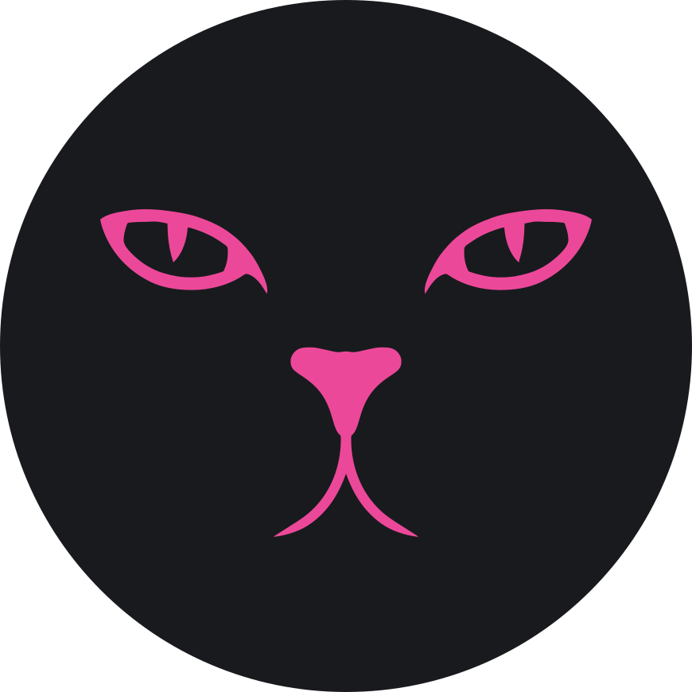 | **Pink** | `pink` | `#ec4899` | `rgb(236, 72, 153)` | [SVG](./brand/logos/logo-pink.svg) · [PNG](./brand/logos/logo-pink.png) | [SVG](./brand/icons/icon-pink.svg) · [PNG](./brand/icons/icon-pink.png) · [ICO](./brand/icons/icon-pink.ico) | [SVG](./brand/banners/banner-pink.svg) · [PNG](./brand/banners/banner-pink.png) |
|  | 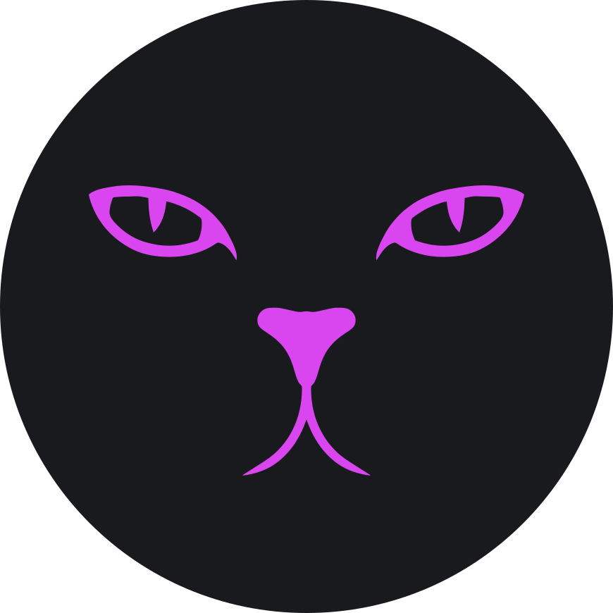 | **Magenta** | `magenta` | `#d946ef` | `rgb(217, 70, 239)` | [SVG](./brand/logos/logo-magenta.svg) · [PNG](./brand/logos/logo-magenta.png) | [SVG](./brand/icons/icon-magenta.svg) · [PNG](./brand/icons/icon-magenta.png) · [ICO](./brand/icons/icon-magenta.ico) | [SVG](./brand/banners/banner-magenta.svg) · [PNG](./brand/banners/banner-magenta.png) |
|  | 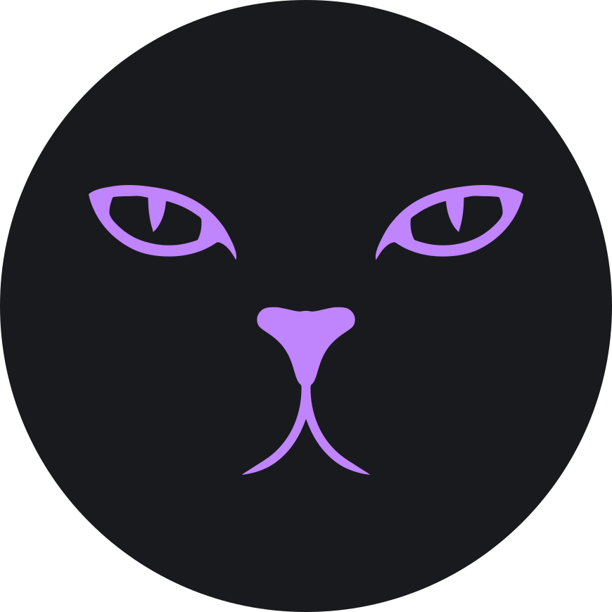 | **Lavender** | `lavender` | `#c084fc` | `rgb(192, 132, 252)` | [SVG](./brand/logos/logo-lavender.svg) · [PNG](./brand/logos/logo-lavender.png) | [SVG](./brand/icons/icon-lavender.svg) · [PNG](./brand/icons/icon-lavender.png) · [ICO](./brand/icons/icon-lavender.ico) | [SVG](./brand/banners/banner-lavender.svg) · [PNG](./brand/banners/banner-lavender.png) |
|  | 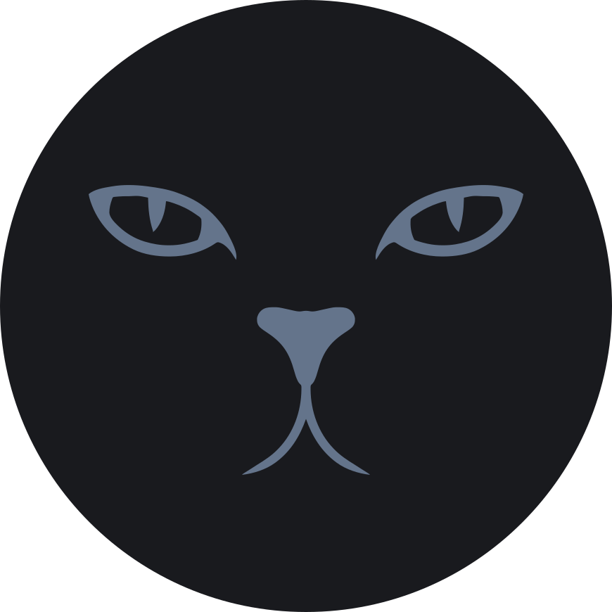 | **Slate** | `slate` | `#64748b` | `rgb(100, 116, 139)` | [SVG](./brand/logos/logo-slate.svg) · [PNG](./brand/logos/logo-slate.png) | [SVG](./brand/icons/icon-slate.svg) · [PNG](./brand/icons/icon-slate.png) · [ICO](./brand/icons/icon-slate.ico) | [SVG](./brand/banners/banner-slate.svg) · [PNG](./brand/banners/banner-slate.png) |
|  | 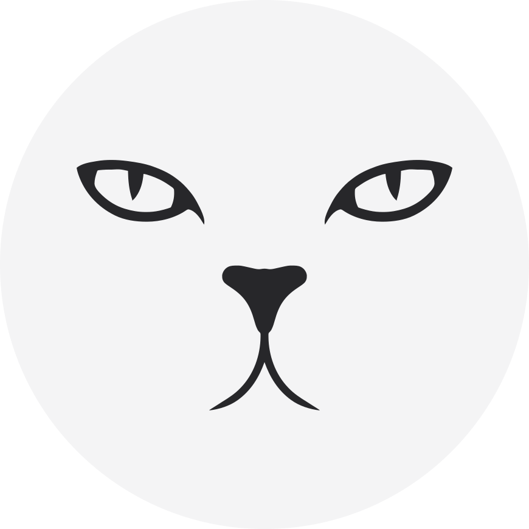 | **Charcoal** | `charcoal` | `#27272a` | `rgb(39, 39, 42)` | [SVG](./brand/logos/logo-charcoal.svg) · [PNG](./brand/logos/logo-charcoal.png) | [SVG](./brand/icons/icon-charcoal.svg) · [PNG](./brand/icons/icon-charcoal.png) · [ICO](./brand/icons/icon-charcoal.ico) | [SVG](./brand/banners/banner-charcoal.svg) · [PNG](./brand/banners/banner-charcoal.png) |
|  | 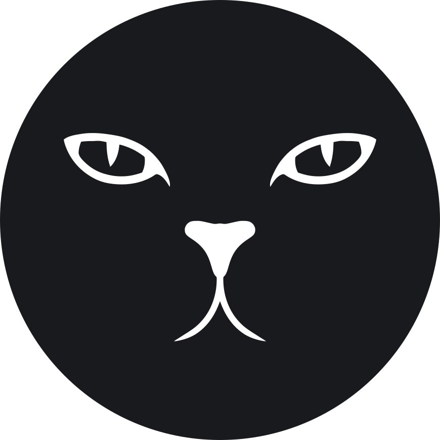 | **White** | `white` | `#ffffff` | `rgb(255, 255, 255)` | [SVG](./brand/logos/logo-white.svg) · [PNG](./brand/logos/logo-white.png) | [SVG](./brand/icons/icon-white.svg) · [PNG](./brand/icons/icon-white.png) · [ICO](./brand/icons/icon-white.ico) | [SVG](./brand/banners/banner-white.svg) · [PNG](./brand/banners/banner-white.png) |
|  | 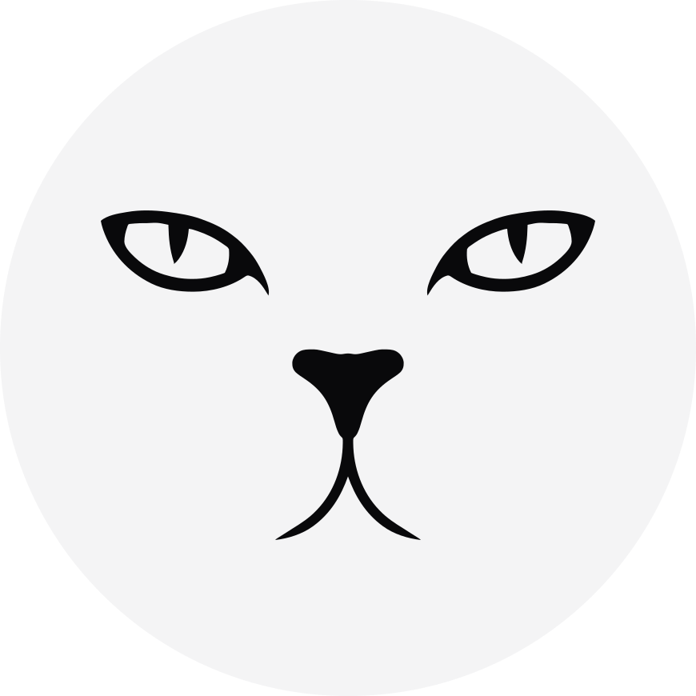 | **Black** | `black` | `#09090b` | `rgb(9, 9, 11)` | [SVG](./brand/logos/logo-black.svg) · [PNG](./brand/logos/logo-black.png) | [SVG](./brand/icons/icon-black.svg) · [PNG](./brand/icons/icon-black.png) · [ICO](./brand/icons/icon-black.ico) | [SVG](./brand/banners/banner-black.svg) · [PNG](./brand/banners/banner-black.png) |

---

## 🤖 Official Discord Applications Media Kit (`Virtue`, `YourApps`, `TDL`, `Zodiac` & `Metamorphosis`)

Official first-party Discord applications developed by **Xernerx Studios** carry their own distinct visual identity, color palette, production imagery, and monochrome beta/canary assets in [`./brand/applications/`](./brand/applications) (and hosted at `https://www.xernerx.com/applications/<app>/`).

| Icon | Application | Slogan | Official Primary Color | Production Assets | Beta / Canary Assets |
| :---: | :--- | :--- | :--- | :---: | :---: |
| 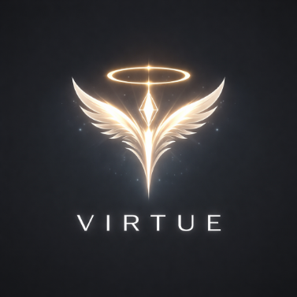 | **[Virtue](https://www.xernerx.com/applications/virtue)**<br /><sub>Global & Server Discord Leveling Bot (`1484880634844287138`)</sub> | *Track. Grow. Ascend.* |  **Celestial Gold** (`#f59e0b`) | [Icon PNG](./brand/applications/virtue/icon.png) · [Icon ICO](./brand/applications/virtue/icon.ico) · [Banner PNG](./brand/applications/virtue/banner.png) | [Beta Icon PNG](./brand/applications/virtue/icon-beta.png) · [Beta Icon ICO](./brand/applications/virtue/icon-beta.ico) · [Beta Banner PNG](./brand/applications/virtue/banner-beta.png) |
|  | **[YourApps](https://www.xernerx.com/applications)**<br /><sub>Discord-Native Forms & Applications Bot (`619328560141697036`)</sub> | *Discord Forms & Applications* |  **Paper Plane Orange** (`#f97316`) | [Icon PNG](./brand/applications/yourapps/icon.png) · [Icon ICO](./brand/applications/yourapps/icon.ico) · [Banner PNG](./brand/applications/yourapps/banner.png) | [Beta Icon PNG](./brand/applications/yourapps/icon-beta.png) · [Beta Icon ICO](./brand/applications/yourapps/icon-beta.ico) · [Beta Banner PNG](./brand/applications/yourapps/banner-beta.png) |
|  | **[To-Do List Bot (TDL)](https://app.xernerx.com/bots/todo)**<br /><sub>Collaborative Discord Task Boards & Checklists (`782105629572464652`)</sub> | *Collaborative Discord Task Boards & Checklists* |  **TDL Leaf Green** (`#71cc2e`) | [Icon PNG](./brand/applications/todo/icon.png) · [Icon ICO](./brand/applications/todo/icon.ico) · [Banner PNG](./brand/applications/todo/banner.png) | [Beta Icon PNG](./brand/applications/todo/icon-beta.png) · [Beta Icon ICO](./brand/applications/todo/icon-beta.ico) · [Beta Banner PNG](./brand/applications/todo/banner-beta.png) |
| 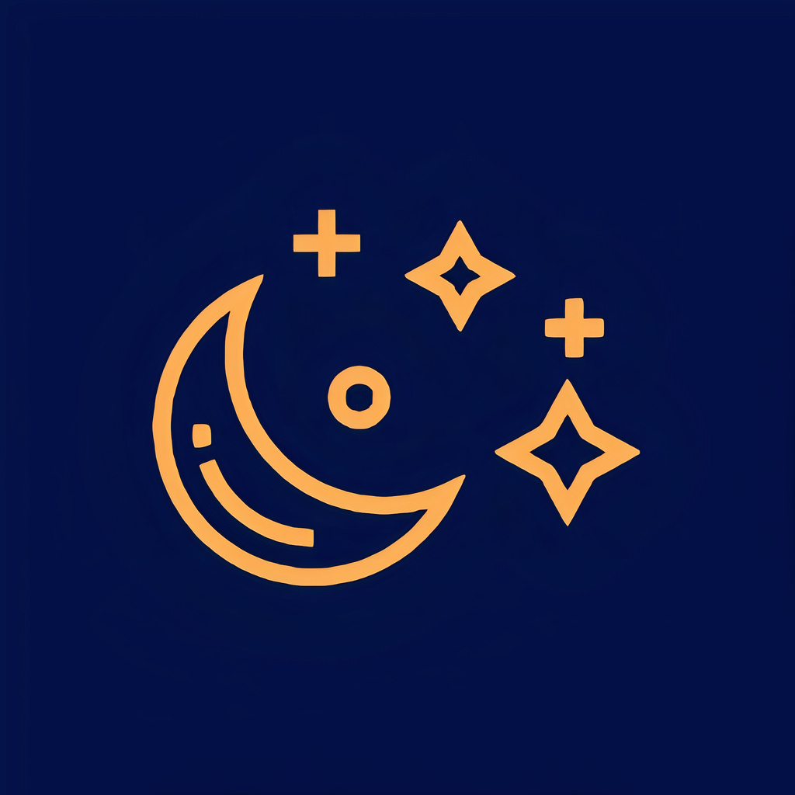 | **[Zodiac](https://app.xernerx.com/bots/zodiac)**<br /><sub>Daily Horoscopes, Sign Profiles & Cosmic Compatibility (`950251264095162418`)</sub> | *Daily Horoscopes & Astrology* |  **Zodiac Bronze** (`#8b520f`) | [Icon PNG](./brand/applications/zodiac/icon.png) · [Icon ICO](./brand/applications/zodiac/icon.ico) · [Banner PNG](./brand/applications/zodiac/banner.png) | [Beta Icon PNG](./brand/applications/zodiac/icon-beta.png) · [Beta Icon ICO](./brand/applications/zodiac/icon-beta.ico) · [Beta Banner PNG](./brand/applications/zodiac/banner-beta.png) |
| 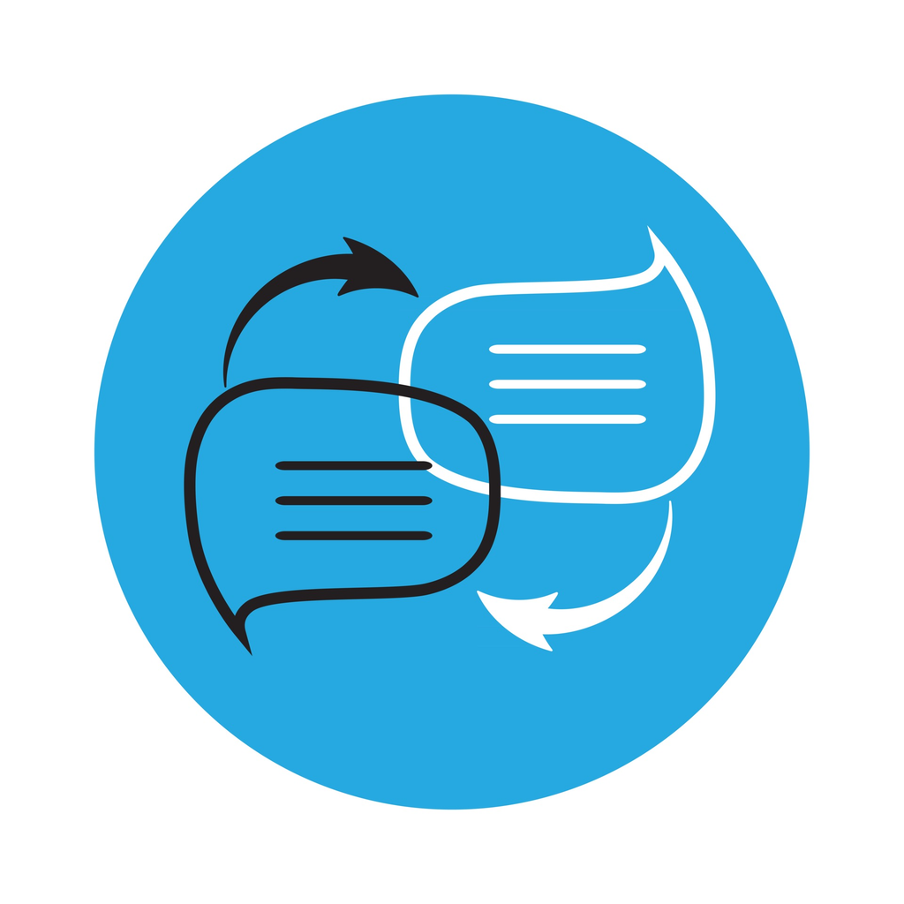 | **[Metamorphosis](https://app.xernerx.com/bots/metamorphosis)**<br /><sub>Dynamic Voice Channels & Community Automation (`881678826906730547`)</sub> | *Dynamic Voice & Community Automation* |  **Dialogue Sky Blue** (`#199fd9`) | [Icon PNG](./brand/applications/metamorphosis/icon.png) · [Icon ICO](./brand/applications/metamorphosis/icon.ico) · [Banner PNG](./brand/applications/metamorphosis/banner.png) | [Beta Icon PNG](./brand/applications/metamorphosis/icon-beta.png) · [Beta Icon ICO](./brand/applications/metamorphosis/icon-beta.ico) · [Beta Banner PNG](./brand/applications/metamorphosis/banner-beta.png) |

---

### 1. Virtue — Official Imagery & Color Palette

<p align="center">
  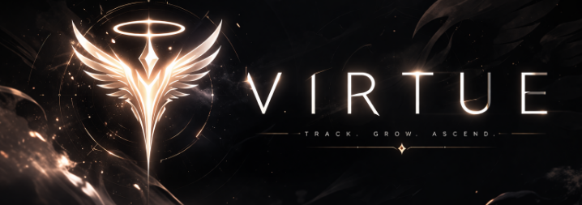
</p>

| Production Icon | Production Banner | Beta / Canary Icon | Beta / Canary Banner |
| :---: | :---: | :---: | :---: |
|  |  | 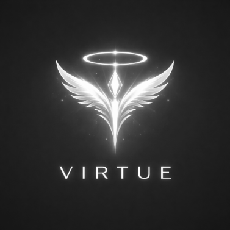 | 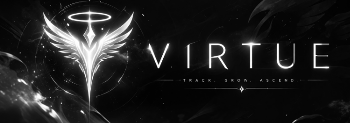 |

#### Virtue Color Tokens

| Swatch | Color Name | Xernerx Preset | Hex | RGB | Role in Virtue Identity |
| :---: | :--- | :--- | :--- | :--- | :--- |
|  | **Celestial Gold** *(Primary)* | `gold` | `#f59e0b` | `rgb(245, 158, 11)` | Primary Halo ring, outer wing radiance, and default XP milestone highlight |
|  | **Warm Champagne** | `peach` | `#fdba74` | `rgb(253, 186, 116)` | Inner angelic feather glow and warm celestial particle accents |
|  | **Radiant Ivory** | `white` | `#fff7ed` | `rgb(255, 247, 237)` | Central diamond core, starlight flares, and `VIRTUE` display lettering |
|  | **Obsidian Void** | `black` | `#18191d` | `rgb(24, 25, 29)` | Deep celestial dark canvas background |

---

### 2. YourApps — Official Imagery & Color Palette

<p align="center">
  
</p>

| Production Icon | Production Banner | Beta / Canary Icon | Beta / Canary Banner |
| :---: | :---: | :---: | :---: |
|  |  |  |  |

#### YourApps Color Tokens

| Swatch | Color Name | Xernerx Preset | Hex | RGB | Role in YourApps Identity |
| :---: | :--- | :--- | :--- | :--- | :--- |
|  | **Paper Plane Orange** *(Primary)* | `orange` | `#f97316` | `rgb(249, 115, 22)` | Origami paper airplane emblem and primary call-to-action accent |
|  | **Sparkle Peach** | `peach` | `#fdba74` | `rgb(253, 186, 116)` | Flight trajectory swoop arc and 4-point star sparkles |
|  | **Ocean Teal** | `cyan` | `#1e5f74` | `rgb(30, 95, 116)` | Atmospheric teal-blue background gradient midtone |
|  | **Deep Navy Canvas** | `charcoal` | `#162238` | `rgb(22, 34, 56)` | Deep navy gradient base and bold illustration outline stroke |

---

### 3. To-Do List Bot (TDL) — Official Imagery & Color Palette

<p align="center">
  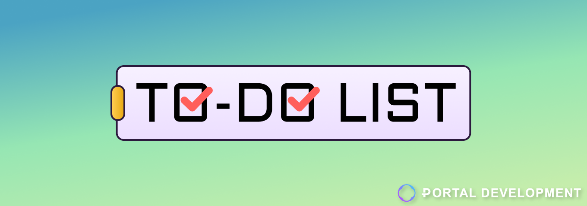
</p>

| Production Icon | Production Banner | Beta / Canary Icon | Beta / Canary Banner |
| :---: | :---: | :---: | :---: |
|  |  | 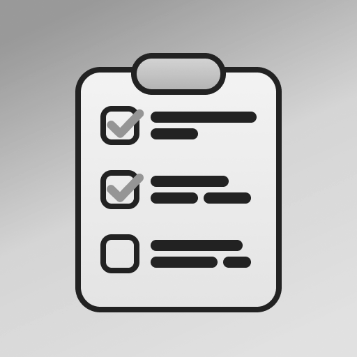 | 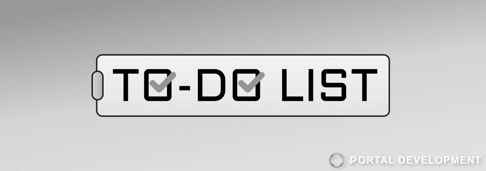 |

#### To-Do List Bot (TDL) Color Tokens

| Swatch | Color Name | Xernerx Preset | Hex | RGB | Role in TDL Identity |
| :---: | :--- | :--- | :--- | :--- | :--- |
|  | **TDL Leaf Green** *(Official Bot Color)* | `lime` | `#71cc2e` | `rgb(113, 204, 46)` | Official To-Do List Bot brand & Discord embed accent color |
|  | **Checkmark Coral** | `coral` | `#ff6363` | `rgb(255, 99, 99)` | Completed task checkmarks and active checklist item highlights |
|  | **Clipboard Gold** | `yellow` | `#f5b82e` | `rgb(245, 184, 46)` | Top clipboard clasp accent and priority task indicator |
|  | **Mint Sage Gradient** | `mint` | `#8de0a6` | `rgb(141, 224, 166)` | Lower-right fresh productivity gradient wash |
|  | **Sky Azure Gradient** | `sky` | `#4392c7` | `rgb(67, 146, 199)` | Upper-left sky gradient base |

---

### 4. Zodiac — Official Imagery & Color Palette

<p align="center">
  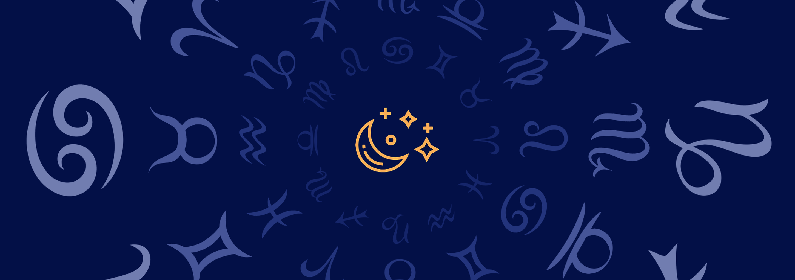
</p>

| Production Icon | Production Banner | Beta / Canary Icon | Beta / Canary Banner |
| :---: | :---: | :---: | :---: |
|  |  | 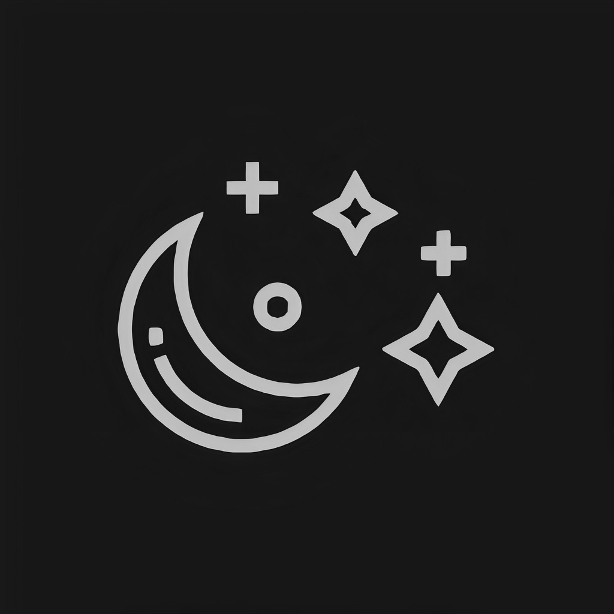 | 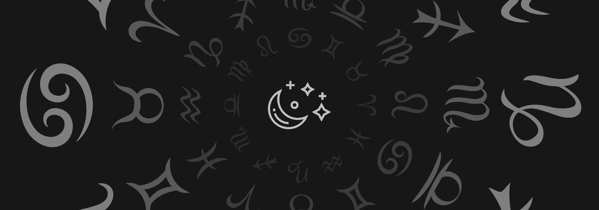 |

#### Zodiac Color Tokens

| Swatch | Color Name | Xernerx Preset | Hex | RGB | Role in Zodiac Identity |
| :---: | :--- | :--- | :--- | :--- | :--- |
|  | **Zodiac Bronze** *(Official Bot Color)* | `gold` | `#8b520f` | `rgb(139, 82, 15)` | Official Zodiac brand & Discord embed accent color |
|  | **Crescent Amber Gold** | `orange` | `#fbb040` | `rgb(251, 176, 64)` | Crescent moon and 4-point star emblem |
|  | **Constellation Periwinkle** | `indigo` | `#6d78ad` | `rgb(109, 120, 173)` | Radial zodiac sign wheel glyphs |
|  | **Midnight Cosmos Navy** | `cobalt` | `#00104a` | `rgb(0, 16, 74)` | Deep night sky canvas background |

---

### 5. Metamorphosis — Official Imagery & Color Palette

<p align="center">
  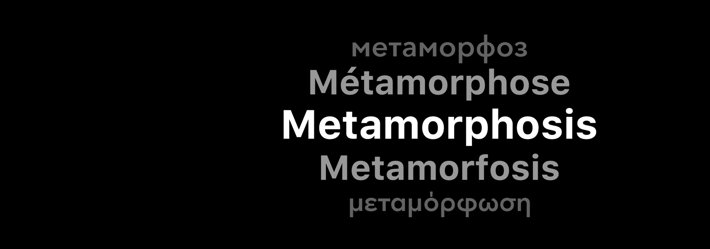
</p>

| Production Icon | Production Banner | Beta / Canary Icon | Beta / Canary Banner |
| :---: | :---: | :---: | :---: |
|  |  | 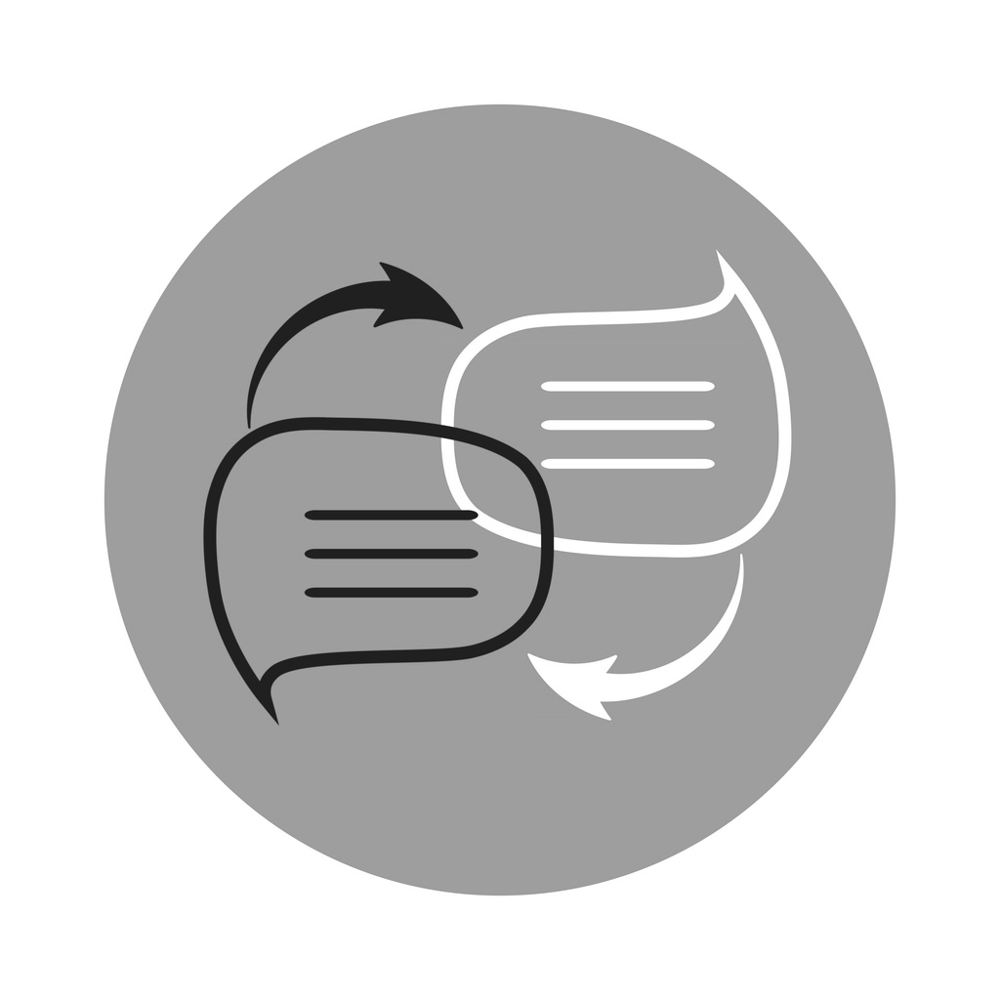 |  |

#### Metamorphosis Color Tokens

| Swatch | Color Name | Xernerx Preset | Hex | RGB | Role in Metamorphosis Identity |
| :---: | :--- | :--- | :--- | :--- | :--- |
|  | **Dialogue Sky Blue** *(Primary)* | `sky` | `#199fd9` | `rgb(25, 159, 217)` | Circular icon disc and primary brand accent |
|  | **Crisp White** | `white` | `#ffffff` | `rgb(255, 255, 255)` | Foreground speech bubble and primary banner wordmark |
|  | **Obsidian Black** | `black` | `#000000` | `rgb(0, 0, 0)` | Counter-speech bubble and banner canvas |

---

### 6. Additional & Legacy Service Brand Colors

| Swatch | Service / Project | Xernerx Preset | Hex | RGB | Role |
| :---: | :--- | :--- | :--- | :--- | :--- |
|  | **Roblox Utilities** | `white` | `#f5f3f1` | `rgb(245, 243, 241)` | Official Warm Alabaster brand & embed accent color for Roblox Utilities |

---

## 📦 Official SDK Package Media Kit (`@xernerx/*`)

Each open-source TypeScript SDK package in the Xernerx ecosystem has an assigned official Xernerx color, a 2–3 letter scope code, a circular package badge icon (`870×870`), and a bespoke architectural banner (`1600×440` @ 2x):

| Icon | Package | Scope | Assigned Color | Package Icon (`870×870`) | Package Banner (`1600×440`) |
| :---: | :--- | :---: | :--- | :---: | :---: |
| 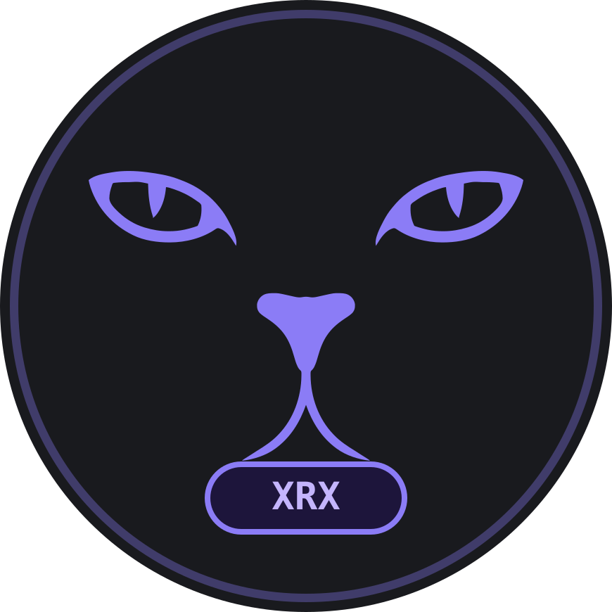 | **[`xernerx`](https://docs.xernerx.com/packages/xernerx)** | `XRX` |  **Purple** (`#8b7cf6`) | [SVG](./brand/packages/icons/xernerx.svg) · [PNG](./brand/packages/icons/xernerx.png) · [ICO](./brand/packages/icons/xernerx.ico) | [SVG](./brand/packages/banners/xernerx.svg) · [PNG](./brand/packages/banners/xernerx.png) |
| 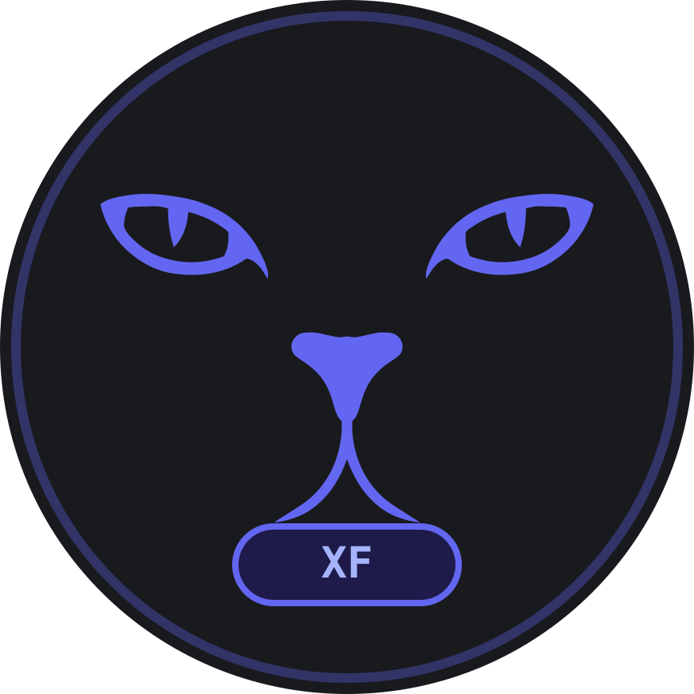 | **[`@xernerx/framework`](https://docs.xernerx.com/packages/@xernerx/framework)** | `XF` |  **Indigo** (`#6366f1`) | [SVG](./brand/packages/icons/framework.svg) · [PNG](./brand/packages/icons/framework.png) · [ICO](./brand/packages/icons/framework.ico) | [SVG](./brand/packages/banners/framework.svg) · [PNG](./brand/packages/banners/framework.png) |
| 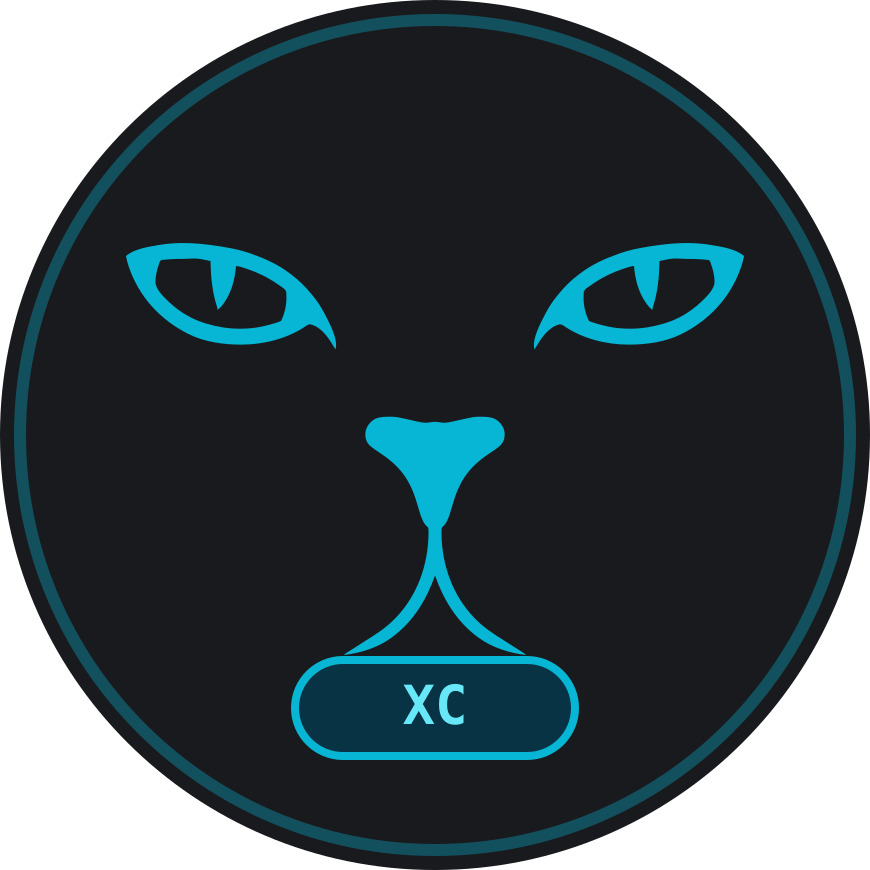 | **[`@xernerx/commands`](https://docs.xernerx.com/packages/@xernerx/commands)** | `XC` |  **Cyan** (`#06b6d4`) | [SVG](./brand/packages/icons/commands.svg) · [PNG](./brand/packages/icons/commands.png) · [ICO](./brand/packages/icons/commands.ico) | [SVG](./brand/packages/banners/commands.svg) · [PNG](./brand/packages/banners/commands.png) |
| 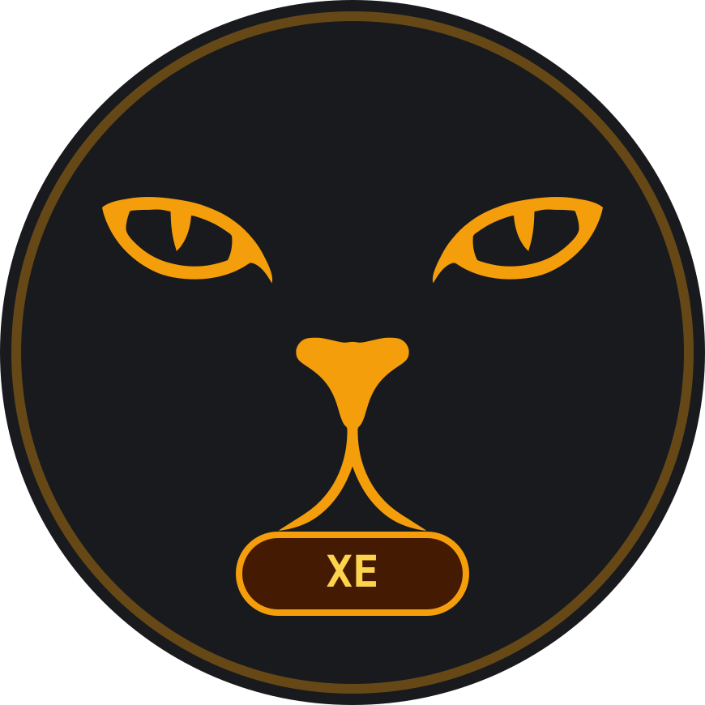 | **[`@xernerx/extension-builder`](https://docs.xernerx.com/packages/@xernerx/extension-builder)** | `XE` |  **Gold** (`#f59e0b`) | [SVG](./brand/packages/icons/extension-builder.svg) · [PNG](./brand/packages/icons/extension-builder.png) · [ICO](./brand/packages/icons/extension-builder.ico) | [SVG](./brand/packages/banners/extension-builder.svg) · [PNG](./brand/packages/banners/extension-builder.png) |
| 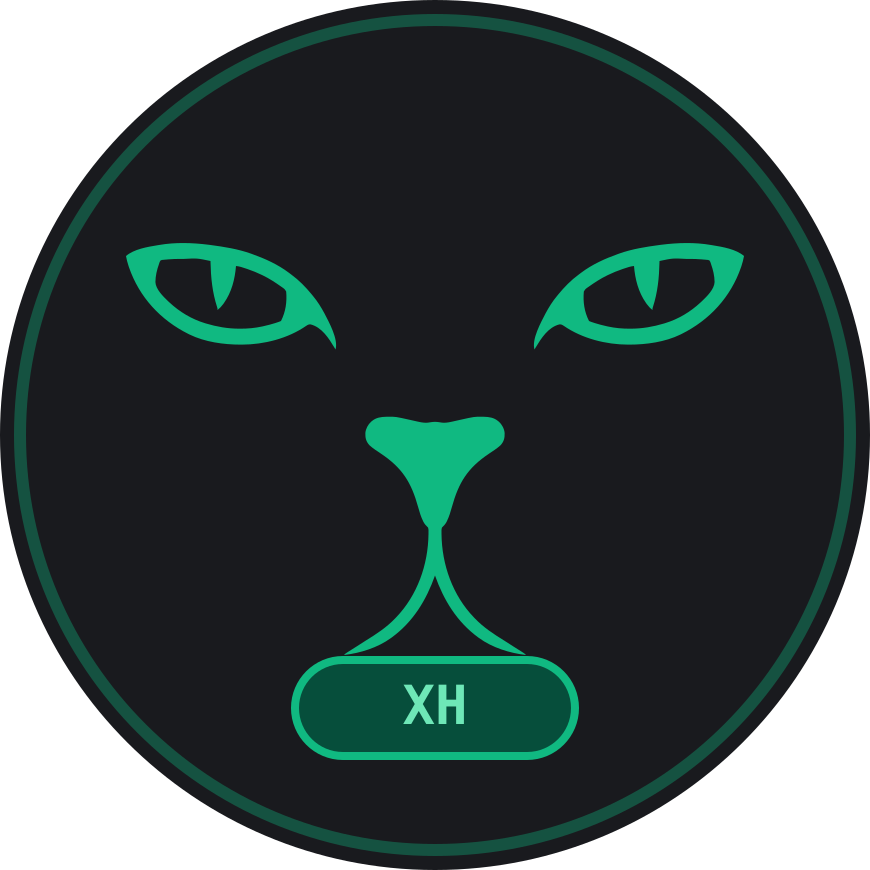 | **[`@xernerx/hooks`](https://docs.xernerx.com/packages/@xernerx/hooks)** | `XH` |  **Emerald** (`#10b981`) | [SVG](./brand/packages/icons/hooks.svg) · [PNG](./brand/packages/icons/hooks.png) · [ICO](./brand/packages/icons/hooks.ico) | [SVG](./brand/packages/banners/hooks.svg) · [PNG](./brand/packages/banners/hooks.png) |
| 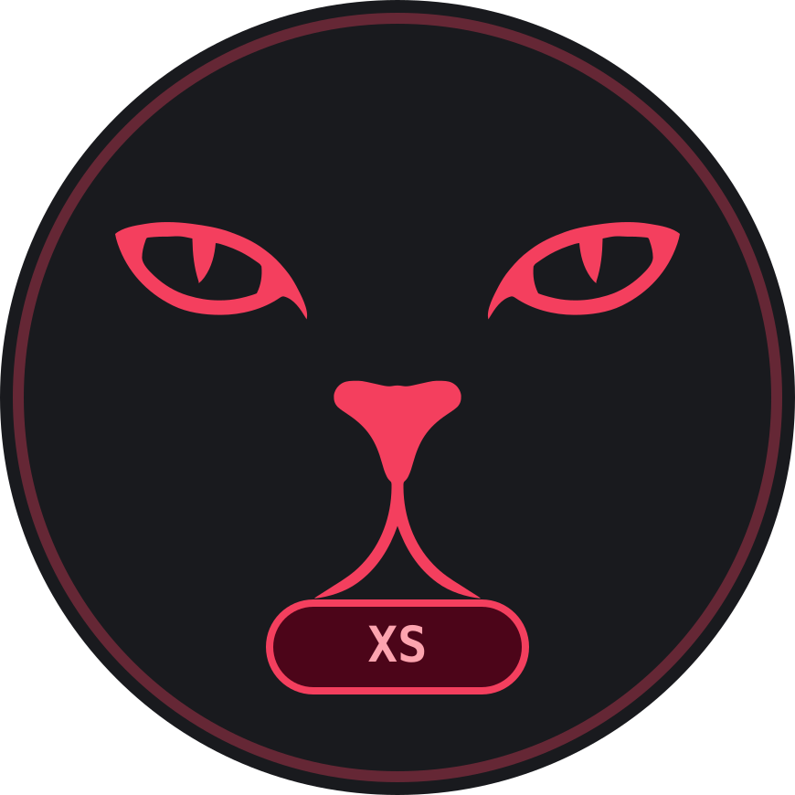 | **[`@xernerx/stats`](https://docs.xernerx.com/packages/@xernerx/stats)** | `XS` |  **Coral** (`#f43f5e`) | [SVG](./brand/packages/icons/stats.svg) · [PNG](./brand/packages/icons/stats.png) · [ICO](./brand/packages/icons/stats.ico) | [SVG](./brand/packages/banners/stats.svg) · [PNG](./brand/packages/banners/stats.png) |
| 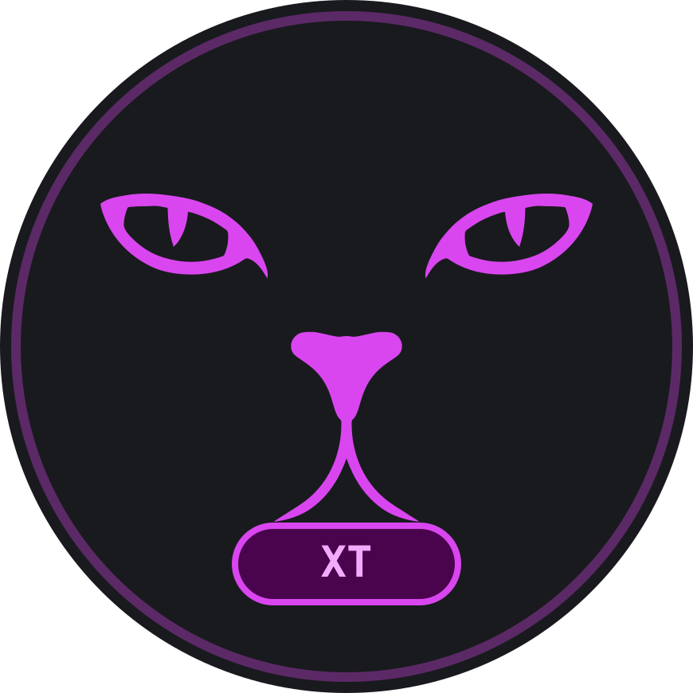 | **[`@xernerx/terminal`](https://docs.xernerx.com/packages/@xernerx/terminal)** | `XT` |  **Magenta** (`#d946ef`) | [SVG](./brand/packages/icons/terminal.svg) · [PNG](./brand/packages/icons/terminal.png) · [ICO](./brand/packages/icons/terminal.ico) | [SVG](./brand/packages/banners/terminal.svg) · [PNG](./brand/packages/banners/terminal.png) |
| 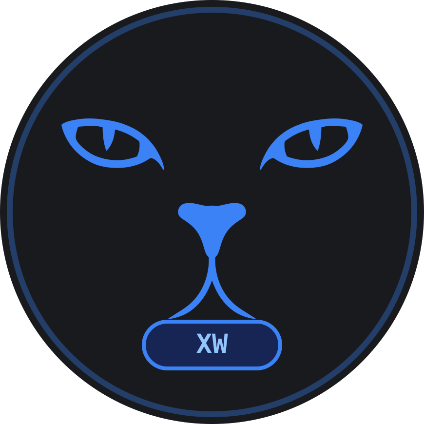 | **[`@xernerx/websocket`](https://docs.xernerx.com/packages/@xernerx/websocket)** | `XW` |  **Blue** (`#3b82f6`) | [SVG](./brand/packages/icons/websocket.svg) · [PNG](./brand/packages/icons/websocket.png) · [ICO](./brand/packages/icons/websocket.ico) | [SVG](./brand/packages/banners/websocket.svg) · [PNG](./brand/packages/banners/websocket.png) |

### Visual Gallery — SDK Package Banners

| `xernerx` (`XRX` · Purple `#8b7cf6`) | `@xernerx/framework` (`XF` · Indigo `#6366f1`) |
| :---: | :---: |
|  |  |
| **`@xernerx/commands` (`XC` · Cyan `#06b6d4`)** | **`@xernerx/extension-builder` (`XE` · Gold `#f59e0b`)** |
|  |  |
| **`@xernerx/hooks` (`XH` · Emerald `#10b981`)** | **`@xernerx/stats` (`XS` · Coral `#f43f5e`)** |
|  |  |
| **`@xernerx/terminal` (`XT` · Magenta `#d946ef`)** | **`@xernerx/websocket` (`XW` · Blue `#3b82f6`)** |
|  |  |

---

## 📏 Brand Usage Guidelines

### ✅ Do's
- **Use Official Color Variants:** Always select from the 27 official Xernerx preset colors or use `logo-white` / `logo-black` when placing marks over busy photography.
- **Maintain Clear Space:** Keep at least **20%** of the mark's width/height as unobstructed padding around the Winged Crest or Wordmark Banner.
- **Use Vector SVGs on the Web:** Prefer `.svg` assets for web pages and Markdown documentation for instant load times and infinite scaling; use `.png` for OpenGraph/social meta tags and `.ico` for native Windows/desktop executables.
- **Pair Official Fonts:** Use **Fredoka** for display headings and UI labels, and **Cascadia Code** for code snippets, CLI commands, and scope badges.

### ❌ Don'ts
- **Do Not Distort or Stretch:** Never alter the aspect ratio (`1:1` for `logo` and `icon`, `2000:990` for `banner`, `40:11` for SDK package banners).
- **Do Not Recolor Arbitrarily:** Do not apply off-palette gradients, drop shadows, or unapproved neon outlines to the Winged Crest.
- **Do Not Imply Official Endorsement:** Community plugins, third-party extensions, and external Discord bots built with `@xernerx/framework` may state *"Built with @xernerx/framework"*, but must not present themselves as official **Xernerx Studios** products without written permission.

---

## ⚖️ Trademark & Licensing Notice

The **Xernerx**, **Xernerx Studios**, and **Xernerx Suite** names, the Winged Crest logo, product icons, and official visual assets in [`./brand/`](./brand) are trademarks and proprietary brand assets of **Xernerx Studios** governed by the **[Xernerx Studios Proprietary & SaaS License v1.0](https://xernerx.com/license)**. Press, community creators, and partner integrations may use these unmodified assets for truthful attribution and editorial reference in accordance with the guidelines above.
